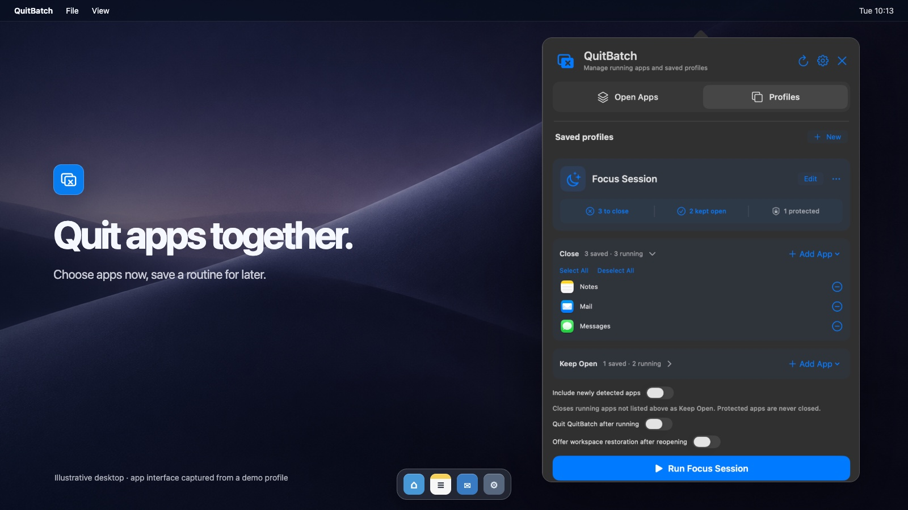
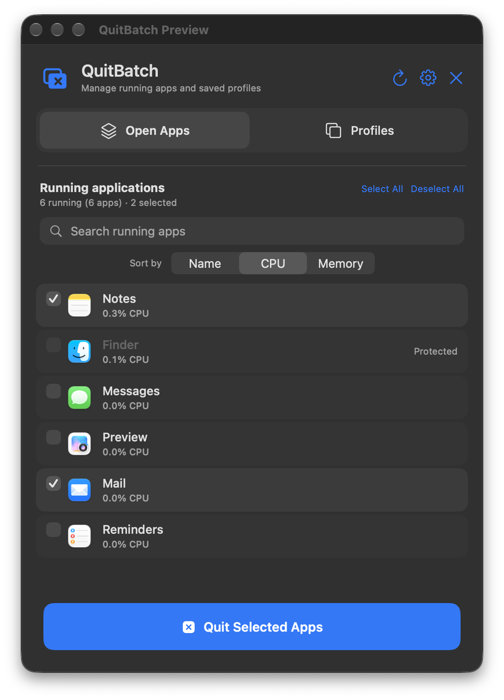
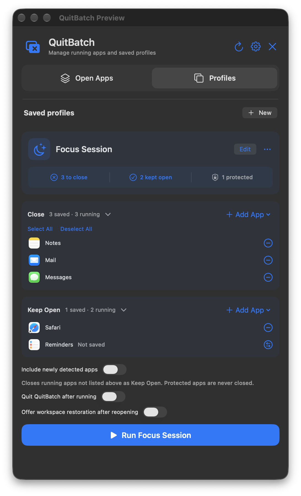
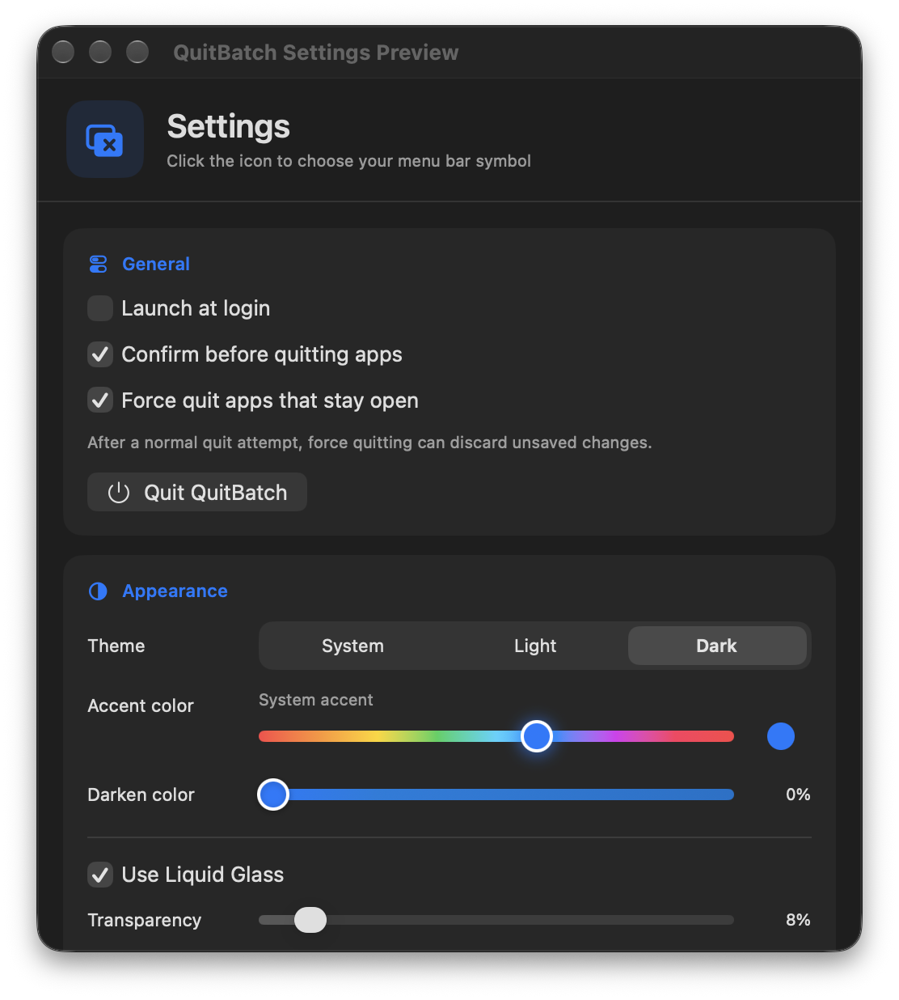

# QuitBatch

Quit a group of Mac apps without hunting through the Dock. Pick from what's running, or save a profile for a routine you repeat. QuitBatch lives in the menu bar and first asks apps to quit normally.



*Illustrative desktop with a real QuitBatch demo interface. The screenshots use a sample “Focus Session” profile and common macOS apps, with no personal app list or documents.*

## What you can do

### Close what's open

Open **Open Apps**, search by app name, and tick the apps you want to quit. Sort the list by name, recent CPU use, or memory footprint to find busy apps quickly. **Select All** and **Deselect All** work on the current search results. QuitBatch shows running instances and distinct apps separately. Protected apps, including Finder, QuitBatch itself, and LockDown Browser, cannot be selected.



### Save a routine

Profiles have two lists: **Close** and **Keep Open**. Add apps from the running list or choose an app bundle. You can fold either list away, edit the profile's name, symbol, and accent, and duplicate or delete it from the More menu. The profile card shows what it would close, keep open, and protect right now. These counts may differ from the number of saved rules because one app can have multiple running instances.

Turn on **Include newly detected apps** if anything you haven't listed under Keep Open should also close. You can show or hide the profile list when you have more than one profile. The included **Exam Mode** is an editable example, not a preset you have to use.



### Reach it from the menu bar

Click the menu bar symbol to open or close the panel. Clicking outside also dismisses it. The opening fade is brief and respects Reduce Motion. Option-click the symbol for a menu of saved profiles, or record a keyboard shortcut in Settings. The panel can be resized from its lower-right corner.

### Make it yours

Settings has system, light, and dark appearance; a choice of menu bar symbols; and a custom accent hue. **Darken color** adjusts the accent from 0 to 100% without dimming the window background. You can also change the glass transparency, show or hide the profile list, launch at login, require confirmation before quitting apps, and quit QuitBatch itself. The Settings window keeps a consistent size and scrolls when space is limited.



## Before you use a profile

QuitBatch gives apps four seconds to respond to a normal quit request. If some remain, the result panel offers **Force Quit Remaining** with a confirmation. Settings also has **Force quit apps that stay open** for automatic escalation. Force quitting can discard unsaved changes. Protected apps and apps marked Keep Open in a profile are excluded from both stages. macOS may still prevent some processes from closing or restart them automatically. Optional workspace restoration remembers app bundles that actually quit and offers to reopen them later; it does not restore unsaved documents or exact window positions.

## Build

QuitBatch targets macOS 14 or later on Apple silicon. With Xcode command line tools installed, run:

```sh
Scripts/test.sh
Scripts/build.sh
```

The build script prints the location of the signed app bundle in the temporary build directory. The bundle identifier remains `com.vladikmartinez.appcloser` so existing settings and profiles keep working after the name change. Saved state remains in the `App Closer` Application Support folder.

## License

QuitBatch is released under the [MIT License](LICENSE). macOS and third-party app names and icons shown in screenshots belong to their respective owners.
